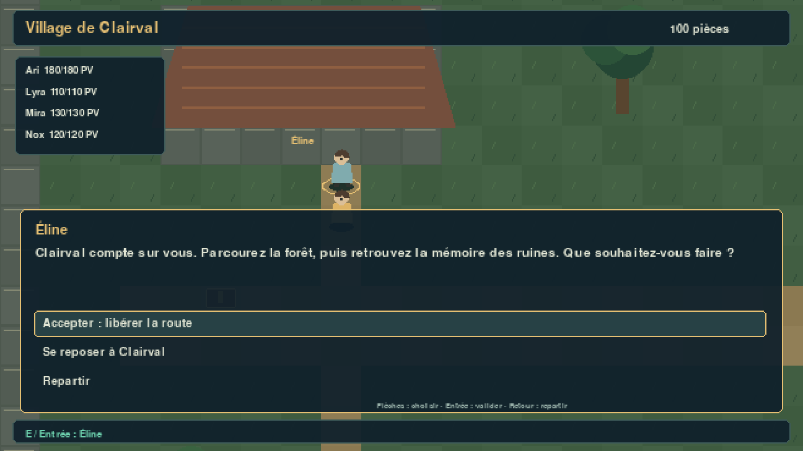

# JRPG — mini-aventure et sauvegardes

Référence normative : [CAHIER_DES_CHARGES_RPG_PYGAME_CODEX.md](../CAHIER_DES_CHARGES_RPG_PYGAME_CODEX.md).
Le projet `JRPG/` propose trois cartes reliées, quatre héros, des combats jouables,
une campagne principale en trois chapitres, trois quêtes secondaires, du commerce
et des sauvegardes.
Le prototype historique `poo/` et ses assets sont préservés. La phase 5 est validée
par l'utilisateur ; la phase 6 est en cours. Ari, Lyra, Mira et Nox utilisent
désormais des atlas peints originaux, inspirés des sprites et prompts historiques.
Les loups et flans reprennent leurs sprites et attaques de `poo`. Les trois cartes
ont de nouvelles peintures, avec eau, feuillage, fumée et lumières animés.
Spectres, gardiens des ronces et corbeaux complètent le bestiaire avec des atlas
peints originaux. Le catalogue comporte douze compétences de héros, quinze objets
dont dix équipements, et cinq PNJ interactifs.

## Lancer

Python 3.15+ et uv sont nécessaires. Depuis la racine :

```bash
cd JRPG
uv run --no-sync jrpg
```

Autre lancement : `uv run --no-sync python -m JRPG`. Pour une première installation,
l'utilisateur exécute `uv sync --locked` ; l'agent n'installe aucune dépendance.
Les commandes concernent le projet dans `JRPG/`, pas le pyproject historique.

La fenêtre s'adapte au bureau et se redimensionne, sans bandes noires. Le champ
visible suit son format et l'interface demeure entièrement visible. La boucle
est plafonnée à 60 FPS ; le débit réel reste à mesurer sur le bureau.

## Explorer et progresser

```text
Village de Clairval ⇄ Forêt des murmures ⇄ Ruines de Sylve
```

Le groupe commence à Clairval. Parlez à **Éline**, au nord du départ, pour accepter
la mission de route. Un coffre est à l'ouest du départ. Suivez le chemin à l'est
et utilisez E près du passage pour entrer dans la forêt.

Vainquez les loups du sentier, puis revenez chez Éline pour recevoir la récompense
et accepter **La mémoire de Sylve**. Oren, dans l'est du village au nord du chemin,
vend des potions et équipements. Éline permet aussi de se reposer gratuitement.

Dans la forêt, le voyageur propose une recherche de coffre sur la rive ouest,
au nord du pont. Traversez le pont puis continuez vers l'est pour atteindre les
ruines. Lisez l'inscription auprès de l'archiviste, au sud de la cour, et vainquez
les gardiens. Revenez chez Éline pour remettre cette quête et accepter
**Le serment de la Sentinelle**. Reposez-vous, puis retournez au nord des ruines
pour affronter la Sentinelle. Ce combat interdit la fuite. Quand la charge est
annoncée, utilisez **Défendre** avant son prochain tour pour réduire les dégâts
du balayage collectif. Revenez ensuite chez Éline pour recevoir le Sceau de Sylve
et conclure le voyage. Les faits déjà accomplis
comptent aussi si une quête est acceptée plus tard.

Tala, au sud-est du carrefour de Clairval, propose une deuxième quête secondaire :
vérifier la réserve de remèdes au sud-ouest de la forêt. L'archiviste propose
« Apaiser les lisières » : vaincre les corbeaux au sud-ouest de la forêt, le gardien
des ronces au sud-est, puis les spectres à l'est des ruines. Les spectres craignent
le givre, les ronces le feu ; les corbeaux peuvent infliger le silence.

| Contrôle | Action |
| --- | --- |
| Flèches, ZQSD ou WASD | Marcher |
| E, Entrée ou Espace | Parler, ouvrir, emprunter un passage, affronter une rencontre |
| Flèches puis Entrée dans un dialogue | Choisir une réponse |
| Retour arrière | Repartir / revenir au menu précédent |
| Tab | Ouvrir ou fermer le menu du groupe |
| I / C / J | Inventaire / fiches de personnages / journal des quêtes |
| F5 / F9 | Choisir un emplacement de sauvegarde / chargement |
| Échap ou croix | Quitter |
| Perte de focus | Pause et arrêt des touches détenues |

Le groupe conserve ses PV/PM, XP, équipements, sac et monnaie entre cartes et
combats. Une rencontre vaincue disparaît. Un coffre ouvert ne verse son contenu
qu'une fois. La fuite permet de retenter plus tard ; la défaite ramène le groupe
rétabli à Clairval, sans annuler les coffres et rencontres déjà résolus.



## Groupe, objets et boutique

Tab donne accès au sac, équipements, fiches, équipe, quêtes et sauvegardes.
Les potions soignent et les plumes ressuscitent hors combat. Les équipements
montrent une comparaison avant validation ; retirer une pièce la rend au sac.
Les restrictions de classe et les quantités sont vérifiées par le domaine.

Le menu Équipe place le héros choisi en tête du groupe. Les fiches présentent
niveau, XP, ressources, dix caractéristiques et compétences. Le journal distingue
quêtes verrouillées, disponibles, actives, à remettre et terminées.

Oren possède des stocks limités. Chaque achat/vente transfère une unité ; les
fonds, quantités et stocks insuffisants sont refusés sans changement partiel.
Une pièce portée doit être retirée avant d'apparaître parmi les objets vendables.

Aperçus : [équipements](docs/previews/equipment.png), [fiches](docs/previews/characters.png),
[boutique](docs/previews/shop.png), [quêtes](docs/previews/quests.png).

## Combattre

Nox, Ari, Lyra et Mira ont des compétences différentes. Les actions indisponibles
affichent leur motif ; les tours ennemis sont automatiques.

| Contrôle | Action |
| --- | --- |
| Flèches / Tab | Naviguer dans actions, compétences, objets et cibles |
| Entrée / Espace | Valider |
| 1 à 6, pavé numérique ou symboles AZERTY | Choisir une action |
| Souris | Cliquer une commande puis une cible |
| Retour arrière | Annuler la sélection |
| Page haut / bas | Parcourir le journal |
| Entrée / Continuer après le résultat | Revenir à la carte |

Les animations présentent les résultats métier et bloquent les nouvelles actions.
Elles ne recalculent jamais les dégâts. Les récompenses de combat et de quête
ne sont attribuées qu'une fois, y compris après sauvegarde/chargement.
Les formules restent provisoires et sont documentées dans l'ADR 0003.

## Sauvegarder et charger

**F5**, choisir un des **trois emplacements**, puis Entrée. **F9** permet de charger
un emplacement occupé. Un chargement invalide conserve la partie courante.
La sauvegarde est disponible en exploration, hors combat actif.

Sous Windows : `%LOCALAPPDATA%\technobel-jrpg\saves\slot-1.json` à `slot-3.json`.
Sous Linux/macOS : `$XDG_DATA_HOME/technobel-jrpg/saves`, ou
`~/.local/share/technobel-jrpg/saves` par défaut.

Le format JSON versionné conserve position, groupe, inventaire, équipement,
progression, quêtes, faits du monde, stocks, temps et suite aléatoire. L'écriture
utilise un temporaire puis un remplacement atomique. Voir [saves.md](docs/saves.md).

## Architecture et extension

| Couche | Responsabilité | Dépendances internes autorisées |
| --- | --- | --- |
| `domain` | Personnages, équipe, inventaire, monde, combat, quêtes et commerce | Domaine |
| `application` | Exploration, transactions de récit, consommation et ports de sauvegarde | Application, domaine |
| `infrastructure` | JSON, mapping/restauration, fichiers, fabrique de rencontres et RNG | Infrastructure, application, domaine |
| `presentation` | Contrôleurs, scènes, menus, caméra et rendu Pygame | Présentation, application, domaine |
| `bootstrap` | Composition explicite des dépendances | Toutes les couches |

Définitions et instantanés sont immuables ; les entités protègent leurs opérations.
Le domaine et l'application n'importent jamais Pygame, JSON ou les fichiers.
Le chargement reconstruit un nouveau graphe de session avant publication.

Les [cartes](docs/maps.md) et `src/JRPG/infrastructure/content/adventure.json`
sont embarqués et séparés de l'état du joueur. Leurs références sont validées.
Les dialogues déclarent uniquement des opérations connues ; ils n'exécutent pas
le texte des fichiers. Les prérequis de quête cycliques sont refusés.

Décisions : [fondations](docs/adr/0001-fondations.md), [métier](docs/adr/0002-fondations-metier.md),
[combat](docs/adr/0003-combat-autonome.md), [interface](docs/adr/0004-scene-combat.md),
[exploration](docs/adr/0005-exploration.md), [progression/persistance](docs/adr/0006-progression-sauvegardes.md).

## Vérifier

```bash
uv run --no-sync pytest --cov=JRPG --cov-report=term-missing
uv run --no-sync ruff check .
uv run --no-sync ruff format --check .
uv run --no-sync mypy
```

Les tests SDL utilisent le pilote dummy. Ils couvrent notamment une aventure
complète avec sauvegarde intermédiaire, reprise, conclusion et refus de doublons,
les fichiers corrompus et la conservation de l'ancien fichier en cas d'échec
simulé du remplacement. Résultats locaux Windows/Python 3.15.2 :
**299 tests réussis, couverture globale 91 % (branches incluses), Ruff et mypy
strict OK**.

Les quatre héros ont chacun 16 poses de marche et 8 poses d'action, sur fond
transparent. Les atlas sont embarqués dans `src/JRPG/infrastructure/content/art/`.
Voir les [prompts complets](docs/art/HERO_PROMPTS.md), la
[décision architecturale](docs/adr/0007-assets-peints.md) et la
[validation du lot artistique](docs/VALIDATION_PHASE_6_ART.md).
Les [prompts des cartes](docs/art/WORLD_PROMPTS.md) et l'
[ADR du monde vivant](docs/adr/0008-monde-peint-vivant.md) décrivent les nouveaux
décors, leur alignement sur les collisions et la reprise des animations.
Un [aperçu animé hors ligne](docs/previews/animations.html) montre les cartes
au repos ainsi que les attaques du loup et du flan.
La [Sentinelle et sa quête](docs/adr/0009-sentinelle-et-conclusion.md) ajoutent
un dernier défi avec attaque annoncée et récompense unique.
[Aperçu de la préparation](docs/previews/sentinel-charge.png).
[Validation et recette du boss](docs/VALIDATION_PHASE_6_SENTINEL.md).
Le [catalogue du MVP](docs/VALIDATION_PHASE_6_CONTENT.md), son
[ADR](docs/adr/0010-catalogue-mvp.md) et le [guide d'extension](docs/EXTENDING_CONTENT.md)
décrivent les contenus ajoutés et leur validation. [Aperçu du bestiaire](docs/previews/bestiary.png).

Le contenu des sauvegardes est désormais en version 3. Les anciennes sauvegardes
ne sont pas migrées : relancez une nouvelle partie, puis sauvegardez avec F5.
Pour reproduire le découpage à partir des sources conservées :

```bash
uv run --no-sync python tools/prepare_hero_art.py
```

Exemples et aperçus sans fenêtre :

```bash
uv run --no-sync python examples/foundations.py
uv run --no-sync python examples/battle.py
uv run --no-sync python tools/preview_exploration.py
uv run --no-sync python tools/preview_battle.py
uv run --no-sync python tools/preview_progression.py
uv run --no-sync python tools/preview_living_world.py
uv run --no-sync python tools/preview_sentinel.py
uv run --no-sync python tools/preview_catalog.py
uv run --no-sync python tools/audit_content.py
```

Le build reste une commande de l'utilisateur : `uv build`. Il doit embarquer
les cartes, `combat.json`, `adventure.json` et le dossier `art/`. Aucun nouveau build ni résultat CI distant n'est
présumé. Voir [VALIDATION_PHASE_5.md](docs/VALIDATION_PHASE_5.md) pour la recette.
La phase 6 est autorisée et en cours : équilibrage global, durée réelle de jeu,
écran titre/options, son, performances et distribution desktop restent à finaliser.
